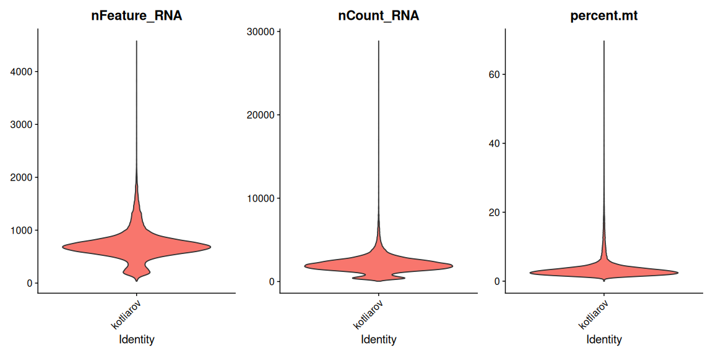
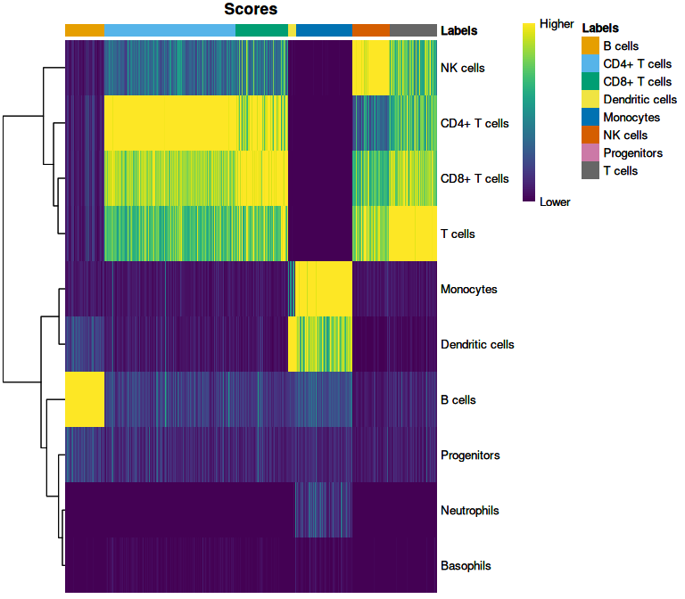
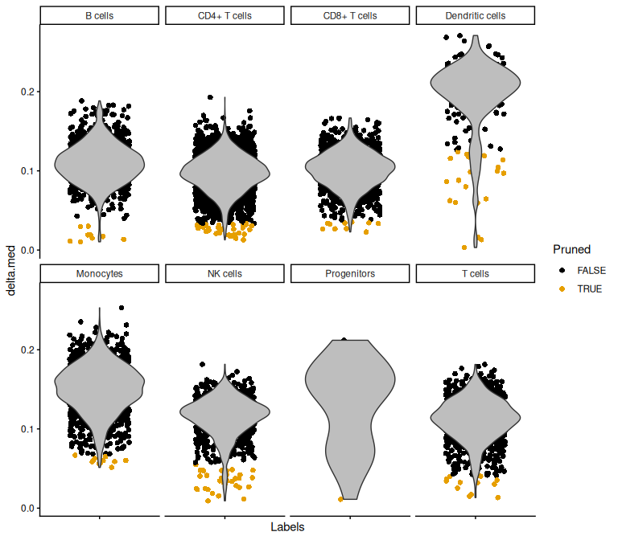
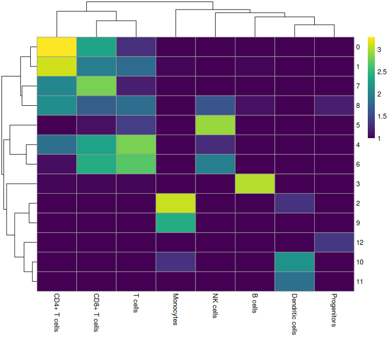
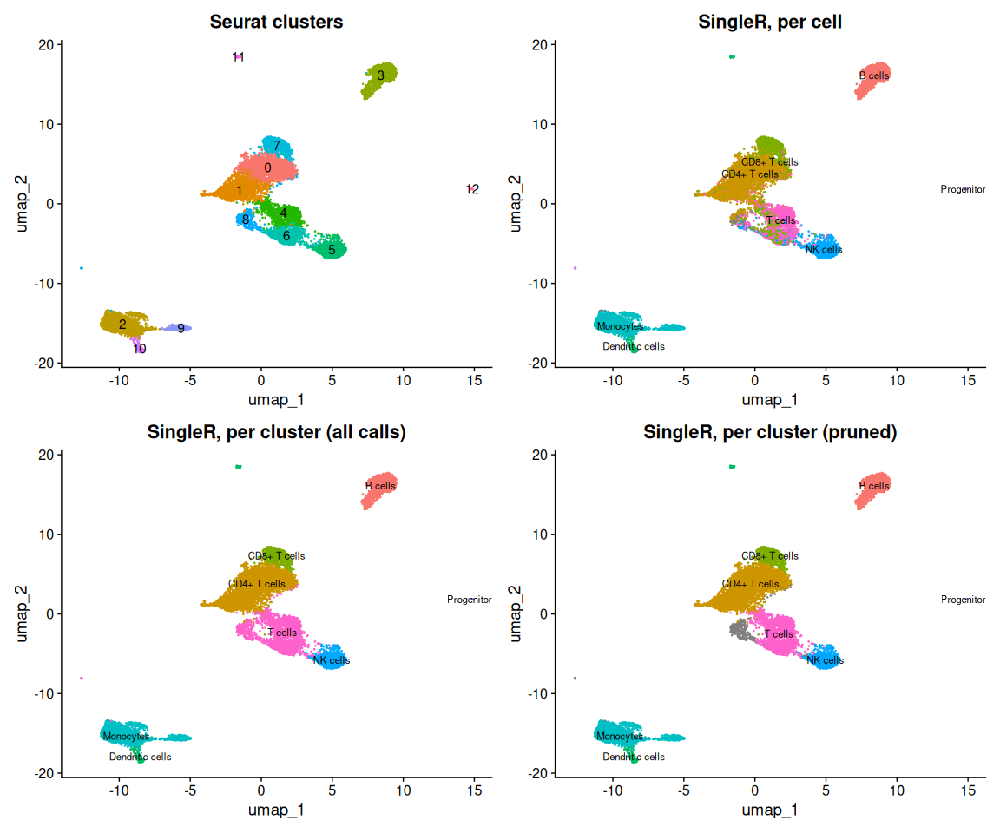
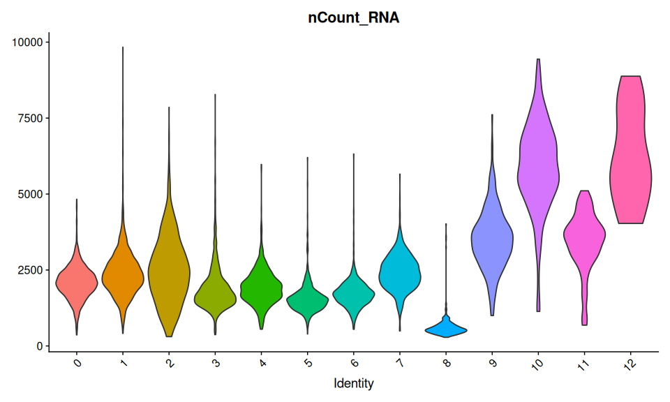
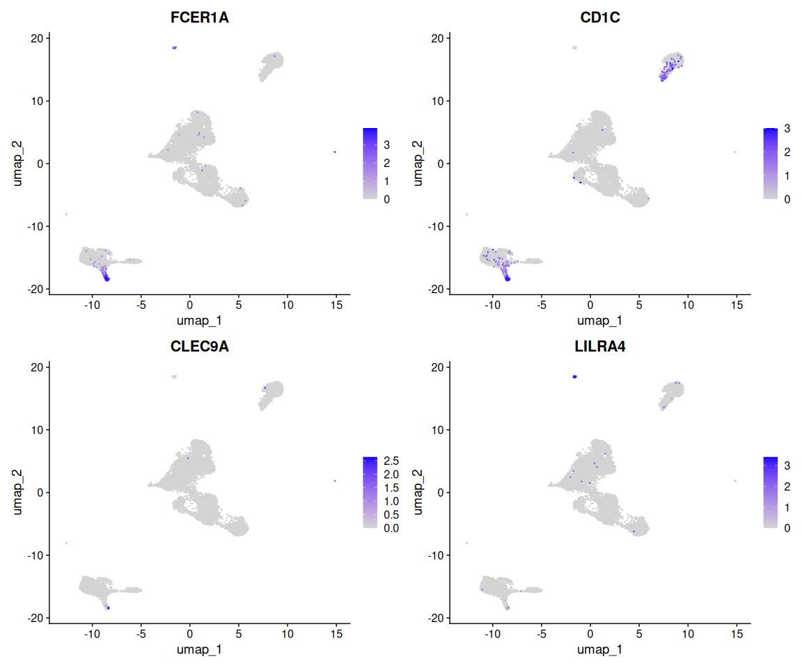
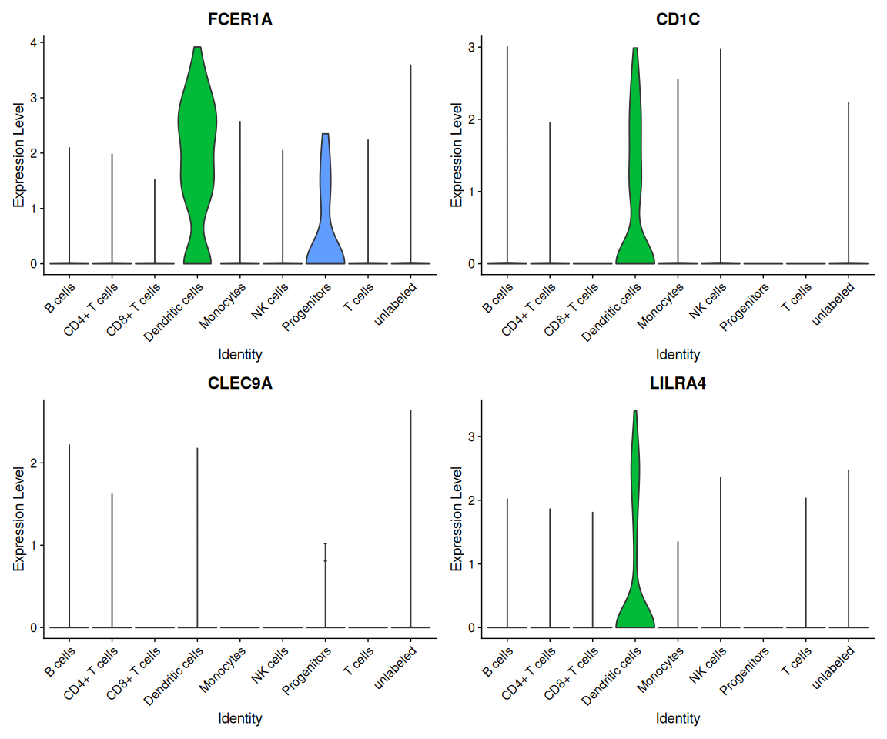

# SingleR: automated cell type annotation


- [Before you start](#before-you-start)
- [Setup](#setup)
- [Get a reference](#get-a-reference)
- [Get some data to annotate](#get-some-data-to-annotate)
- [Run SingleR](#run-singler)
- [Assess the assignments](#assess-the-assignments)
- [Fine-grained labels](#fine-grained-labels)
- [Comparing SingleR to your
  clusters](#comparing-singler-to-your-clusters)
- [Annotating clusters instead of
  cells](#annotating-clusters-instead-of-cells)
- [Labels on a UMAP](#labels-on-a-umap)
- [Checking the annotation against what you
  expect](#checking-the-annotation-against-what-you-expect)
- [A caution about references](#a-caution-about-references)
- [Save your work](#save-your-work)
- [Session information](#session-information)

In the [Seurat intro](01_seurat_intro.md) you annotated clusters by
hand: you looked at the expression of canonical markers, decided what
each cluster was, and typed in the names. That works, but it is slow, it
requires you to already know the markers, and it is hard to defend when
someone asks why cluster 4 is a CD8 T cell and not something else.

SingleR takes a different approach. Given a reference dataset of known
cell types, it correlates each of your cells against that reference and
assigns the best match. It annotates **cells**, not clusters, which
means you can also use it to check whether your clustering is carving
the data at sensible joints.

> **About this tutorial.** This is our own version of a published
> tutorial, rewritten to run in the course container — see the credits
> at the bottom for the original. The original is worth reading too. It
> is what you will find when you search for this analysis, and comparing
> the two is good practice for something you will constantly do in your
> own work: taking a tutorial written for someone else’s setup and
> making it run on yours.

## Before you start

We rendered this tutorial with:

``` bash
interactive -a cusanovichlab -n 8 -t 02:00:00
```

`interactive` allocates memory per core — 4 GB each by default — so that
is **32 GB** in total. Note there is no `--mem` flag: memory comes from
the number of cores you ask for. The default of 1 core and 4 GB is not
enough: the dataset is large before we subsample it.

The code alone takes about **3 minutes** to run, but we obviously expect
you to spend more time on it than that. Plan for at least 30 minutes.
And always ask for more time than you expect to need. A job that hits
its limit is killed part way through.

Also note that when R runs out of memory on the cluster, the scheduler
kills it with no error message. The session simply stops mid-command. If
that ever happens to you, here or anywhere else, memory is the first
thing to check.

## Setup

``` r
library(Seurat)
library(SingleR)
library(celldex)
library(scRNAseq)
library(pheatmap)
library(viridis)
library(ggplot2)

# CHANGE THIS to your NetID.
NETID <- "your_netid"


WORK <- file.path("/xdisk/darrenc/cmm_523", NETID, "singler")
dir.create(file.path(WORK, "output"), recursive = TRUE, showWarnings = FALSE)


WORK
```

    #> [1] "/xdisk/darrenc/cmm_523/your_netid/singler"

## Get a reference

`celldex` provides several curated reference datasets, and choosing
among them matters more than any argument you will pass to `SingleR()`.
The reference defines the entire vocabulary of answers available: a cell
type the reference does not describe cannot be assigned, no matter how
clearly it is present in your data.

Our sample is PBMCs, so we use a reference built from blood.
`MonacoImmuneData` is RNA-seq of sorted immune populations from
peripheral blood, which is as close a match to this experiment as
celldex offers.

The first call downloads and caches the reference, which takes a minute.
The cache location is set by the container, so it lands on `/xdisk`
rather than in your home directory.

``` r
ref <- celldex::MonacoImmuneData()
ref
```

    #> class: SummarizedExperiment 
    #> dim: 46077 114 
    #> metadata(0):
    #> assays(1): logcounts
    #> rownames(46077): A1BG A1BG-AS1 ... ZYX ZZEF1
    #> rowData names(0):
    #> colnames(114): DZQV_CD8_naive DZQV_CD8_CM ... G4YW_Neutrophils
    #>   G4YW_Basophils
    #> colData names(3): label.main label.fine label.ont

Each reference has two label columns. `label.main` is coarse;
`label.fine` is granular. Which you want depends on the question.

``` r
table(ref$label.main)
```

    #> 
    #>         B cells       Basophils    CD4+ T cells    CD8+ T cells Dendritic cells 
    #>              20               4              30              16               8 
    #>       Monocytes     Neutrophils        NK cells     Progenitors         T cells 
    #>              12               4               4               4              12

Every one of those is a blood population, which is the point. A broad
atlas like `HumanPrimaryCellAtlasData()` spans many tissues, and handing
SingleR hepatocytes and keratinocytes as options for a blood sample
gives it opportunities to be wrong in uninteresting ways — with one of
those, you would subset to the relevant lineages first. Here there is
nothing to remove.

## Get some data to annotate

We will use a PBMC dataset from `scRNAseq` rather than the object from
the last tutorial, so this tutorial stands alone.

``` r
sce <- scRNAseq::KotliarovPBMCData()
sce
```

    #> class: SingleCellExperiment 
    #> dim: 32738 58654 
    #> metadata(0):
    #> assays(1): counts
    #> rownames(32738): MIR1302-10 FAM138A ... AC002321.2 AC002321.1
    #> rowData names(0):
    #> colnames(58654): AAACCTGAGAGCCCAA_H1B1ln1 AAACCTGAGGCGTACA_H1B1ln1 ...
    #>   TTTGTCATCGGTTCGG_H1B2ln6 TTTGTCATCTACCTGC_H1B2ln6
    #> colData names(24): nGene nUMI ... dmx_hto_match timepoint

    #> reducedDimNames(0):
    #> mainExpName: NULL

    #> altExpNames(1): ADT

That is around 58,000 cells. Before we subsample or annotate anything,
it gets the same quality control you applied to pbmc3k in the [Seurat
intro](01_seurat_intro.md) — QC comes first, every time, and the point
of doing it again here is that it should start feeling automatic.

``` r
pbmc <- CreateSeuratObject(counts = counts(sce), project = "kotliarov")
pbmc[["percent.mt"]] <- PercentageFeatureSet(pbmc, pattern = "^MT-")

pbmc
```

    #> An object of class Seurat 
    #> 32738 features across 58654 samples within 1 assay 
    #> Active assay: RNA (32738 features, 0 variable features)
    #>  1 layer present: counts

``` r
VlnPlot(pbmc, features = c("nFeature_RNA", "nCount_RNA", "percent.mt"),
        ncol = 3, pt.size = 0) + NoLegend()
```



Look at the distributions before you pick thresholds. Cells with very
few detected genes are usually empty or dying; cells with far more than
the bulk of the population are often two cells in one droplet; and a
high mitochondrial fraction indicates a cell that was damaged or lysing
when it was captured.

Notice that the feature distribution is not one smooth hump. There is
the main population, and below it a separate smaller mode — the
low-quality cells we want to remove. Where exactly you cut between them
is a judgment call, and the conventional 200 lands partway into that
lower mode rather than cleanly beneath it. A somewhat higher threshold
would be equally defensible here. This is the reason to plot before
filtering rather than copying numbers from a vignette.

``` r
pbmc <- subset(
  pbmc,
  subset = nFeature_RNA > 200 & nFeature_RNA < 2500 & percent.mt < 10
)
pbmc
```

    #> An object of class Seurat 
    #> 32738 features across 55321 samples within 1 assay 
    #> Active assay: RNA (32738 features, 0 variable features)
    #>  1 layer present: counts

Those numbers are a starting point borrowed from the Seurat PBMC
vignette, not constants. They are reasonable for 10x PBMC data and wrong
for plenty of other experiments — a tissue with large, transcriptionally
active cells will have many legitimate cells above 2500 features, and
cardiac or muscle tissue runs high on mitochondrial content for real
biological reasons. Read your own distributions and justify your own
cutoffs.

Now subsample, for runtime rather than for quality:

``` r
set.seed(42)
pbmc <- pbmc[, sample(ncol(pbmc), 10000)]
pbmc <- NormalizeData(pbmc)
pbmc
```

    #> An object of class Seurat 
    #> 32738 features across 10000 samples within 1 assay 
    #> Active assay: RNA (32738 features, 0 variable features)
    #>  2 layers present: counts, data

How far down to subsample is a real trade-off. SingleR’s per-cluster
mode pools the cells in each cluster before scoring, so the smaller the
subsample, the fewer cells stand behind each pooled profile and the
noisier those scores get. Ten thousand keeps runtime and memory
reasonable while leaving enough cells in the smaller clusters to say
something about them.

Subsampling for a tutorial is fine. Subsampling for an analysis is a
decision you should make deliberately and report — rare populations are
exactly the ones a random subsample is most likely to lose.

SingleR expects log-normalized expression, which `NormalizeData()` above
has produced. SingleR does not care that the matrix started life as a
`SingleCellExperiment`.

## Run SingleR

``` r
norm_counts <- LayerData(pbmc, assay = "RNA", layer = "data")

pred.main <- SingleR(
  test = norm_counts,
  ref = ref,
  labels = ref$label.main
)

table(pred.main$pruned.labels, useNA = "ifany")
```

    #> 
    #>         B cells    CD4+ T cells    CD8+ T cells Dendritic cells       Monocytes 
    #>            1048            3486            1400             201            1498 
    #>        NK cells     Progenitors         T cells            <NA> 
    #>             962              20            1248             137

Note what we did *not* pass. SingleR chooses marker genes for each label
before scoring anything, and `de.method` controls how. The default,
`"classic"`, ranks genes by log fold change and is built for bulk
references — which is what Monaco is, RNA-seq of sorted populations with
only a handful of samples per label. The alternatives, `"wilcox"` and
`"t"`, are for single-cell references, where each label has hundreds or
thousands of cells to run a test across.

The mismatch matters more than it sounds like it would. Several Monaco
labels rest on four sorted samples; ask for a Wilcoxon test on four
observations and you get unstable markers, and since those markers are
what the correlation scores are computed over, poor marker selection
turns into confident wrong labels downstream. Match the method to the
reference.

`pruned.labels` is the important column. SingleR assigns every cell a
label, but then prunes assignments where the score is not meaningfully
better than the alternatives. Those become `NA`. A cell with `NA` is one
SingleR is not confident about, which is more useful than a confident
wrong answer.

## Assess the assignments

The score heatmap shows, for each cell, how well it matched every label
in the reference. Good assignments look like a single bright band.

``` r
plotScoreHeatmap(pred.main)
```



The delta distribution is the gap between the best score and the median
score for each cell. Small deltas mean the cell matched everything about
equally well, which is a warning sign.

``` r
plotDeltaDistribution(pred.main, ncol = 4, dots.on.top = FALSE)
```



## Fine-grained labels

``` r
pred.fine <- SingleR(
  test = norm_counts,
  ref = ref,
  labels = ref$label.fine
)

head(sort(table(pred.fine$pruned.labels, useNA = "ifany"), decreasing = TRUE), 15)
```

    #> 
    #>             Naive CD4 T cells           Classical monocytes 
    #>                          1703                          1104 
    #>          Natural killer cells             Naive CD8 T cells 
    #>                           914                           731 
    #>                Vd2 gd T cells                 Naive B cells 
    #>                           666                           597 
    #>                     Th1 cells            T regulatory cells 
    #>                           488                           368 
    #>                     Th2 cells     Follicular helper T cells 
    #>                           362                           317 
    #> Terminal effector CD8 T cells                Th1/Th17 cells 
    #>                           305                           296 
    #>                    MAIT cells        Intermediate monocytes 
    #>                           288                           223 
    #>    Central memory CD8 T cells 
    #>                           212

Fine labels are more informative and less reliable. Distinguishing naive
from central memory CD4 T cells from transcriptome alone is genuinely
hard, and the pruning is correspondingly more aggressive. Use fine
labels when you need the resolution, and check the delta plot before you
trust them.

## Comparing SingleR to your clusters

This is where SingleR earns its keep. If you have already clustered your
data, cross-tabulating clusters against SingleR labels tells you whether
the clusters correspond to recognizable cell types.

``` r
pbmc <- AddMetaData(pbmc, pred.main$pruned.labels, col.name = "SingleR_main")

# A quick standard clustering to compare against
pbmc <- FindVariableFeatures(pbmc, nfeatures = 2000)
pbmc <- ScaleData(pbmc)
pbmc <- RunPCA(pbmc, npcs = 20)
pbmc <- FindNeighbors(pbmc, dims = 1:20)
pbmc <- FindClusters(pbmc, resolution = 0.5)
```

    #> Modularity Optimizer version 1.3.0 by Ludo Waltman and Nees Jan van Eck
    #> 
    #> Number of nodes: 10000
    #> Number of edges: 380598
    #> 
    #> Running Louvain algorithm...
    #> Maximum modularity in 10 random starts: 0.9061
    #> Number of communities: 13
    #> Elapsed time: 1 seconds

``` r
tab <- table(cluster = pbmc$seurat_clusters, label = pbmc$SingleR_main)
tab
```

    #>        label
    #> cluster B cells CD4+ T cells CD8+ T cells Dendritic cells Monocytes NK cells
    #>      0        0         1902          204               0         0        0
    #>      1        1         1301           83               0         1        0
    #>      2        0            0            0              11      1243        0
    #>      3     1044            1            1               0         0        0
    #>      4        0           58          198               0         0        9
    #>      5        0            0            3               0         0      840
    #>      6        0            2          245               0         0       83
    #>      7        0          107          630               0         0        0
    #>      8        3          115           36               0         0       30
    #>      9        0            0            0               0       243        0
    #>      10       0            0            0             131        11        0
    #>      11       0            0            0              59         0        0
    #>      12       0            0            0               0         0        0
    #>        label
    #> cluster Progenitors T cells
    #>      0            0      10
    #>      1            0      51
    #>      2            0       0
    #>      3            0       1
    #>      4            0     653
    #>      5            0      16
    #>      6            0     456
    #>      7            0       6
    #>      8            6      55
    #>      9            0       0
    #>      10           0       0
    #>      11           0       0
    #>      12          14       0

``` r
pheatmap(log10(tab + 10), color = viridis::viridis(100))
```



Read this heatmap carefully, because it is diagnostic in both
directions. A cluster that maps cleanly onto one label is well behaved.
A cluster spread across several labels may be under-clustered. Several
clusters mapping to the same label may mean you over-clustered, or may
mean there is real substructure the reference cannot name.

The single most useful summary is the dominant label per cluster:

``` r
apply(tab, 1, function(x) names(which.max(x)))
```

    #>                 0                 1                 2                 3 
    #>    "CD4+ T cells"    "CD4+ T cells"       "Monocytes"         "B cells" 
    #>                 4                 5                 6                 7 
    #>         "T cells"        "NK cells"         "T cells"    "CD8+ T cells" 
    #>                 8                 9                10                11 
    #>    "CD4+ T cells"       "Monocytes" "Dendritic cells" "Dendritic cells" 
    #>                12 
    #>     "Progenitors"

## Annotating clusters instead of cells

Taking the most common label in each cluster, as we just did, is a
reasonable summary but a crude one — it throws away how confident each
call was. SingleR can do the job properly. Pass `clusters=` and it pools
the expression profiles of all cells in a cluster before scoring, then
returns one label per cluster.

``` r
pred.cluster <- SingleR(
  test     = norm_counts,
  ref      = ref,
  labels   = ref$label.main,
  clusters = pbmc$seurat_clusters
)

pred.cluster[, c("labels", "pruned.labels")]
```

    #> DataFrame with 13 rows and 2 columns
    #>              labels   pruned.labels
    #>         <character>     <character>
    #> 0      CD4+ T cells    CD4+ T cells
    #> 1      CD4+ T cells    CD4+ T cells
    #> 2         Monocytes       Monocytes
    #> 3           B cells         B cells
    #> 4           T cells         T cells
    #> ...             ...             ...
    #> 8           T cells              NA
    #> 9         Monocytes       Monocytes
    #> 10  Dendritic cells Dendritic cells
    #> 11  Dendritic cells Dendritic cells
    #> 12      Progenitors     Progenitors

Pooling first means each score is computed from hundreds or thousands of
cells rather than one, so the noise that makes individual assignments
wobble largely cancels out. The cost is that a cluster containing two
cell types gets one label and you lose the evidence that anything was
mixed.

That trade-off is the real choice here. Per-cell labels are a
diagnostic: the disagreement *within* a cluster is information, and a
cluster that comes back speckled is telling you either that it is
under-clustered or that the reference cannot separate what is in it.
Per-cluster labels are what you want once you have settled on a
clustering and need a name for each group.

Note the two columns printed above. `labels` is the call SingleR made
for every cluster. `pruned.labels` is the same thing with the calls
SingleR did not trust replaced by `NA`. Keep both — the difference
between them is the interesting part.

``` r
i <- match(pbmc$seurat_clusters, rownames(pred.cluster))

pbmc$SingleR_cluster        <- pred.cluster$labels[i]
pbmc$SingleR_cluster_pruned <- pred.cluster$pruned.labels[i]
```

## Labels on a UMAP

``` r
pbmc <- RunUMAP(pbmc, dims = 1:20)

p1 <- DimPlot(pbmc, group.by = "seurat_clusters", label = TRUE) +
  NoLegend() + ggtitle("Seurat clusters")
p2 <- DimPlot(pbmc, group.by = "SingleR_main", label = TRUE, label.size = 3) +
  NoLegend() + ggtitle("SingleR, per cell")
p3 <- DimPlot(pbmc, group.by = "SingleR_cluster", label = TRUE, label.size = 3) +
  NoLegend() + ggtitle("SingleR, per cluster (all calls)")
p4 <- DimPlot(pbmc, group.by = "SingleR_cluster_pruned",
              label = TRUE, label.size = 3) +
  NoLegend() + ggtitle("SingleR, per cluster (pruned)")

(p1 + p2) / (p3 + p4)
```



Read these as a sequence. The per-cell panel shows where individual
cells were ambiguous — speckling means either the cluster holds more
than one thing or the reference cannot separate what is in it. The two
per-cluster panels are the same analysis shown twice: bottom left is
every call SingleR made, bottom right is those calls with the untrusted
ones greyed out.

Grey is not a cell type and not an error. It is a cluster whose label
SingleR declined to stand behind, and the panel beside it shows what
that label would have been.

Seurat numbers clusters by size, so the highest numbers are the smallest
clusters, and in general it is those that give SingleR the most trouble.
Had we skipped the QC step above, more clusters would have come back
unlabeled — filtering removed much of the problem before annotation ever
ran, which is the argument for doing QC first in one picture.

When a cluster does come back grey, the usual explanations are: a cell
type your reference does not describe, collisions (two cells in one
droplet), a cluster that is really two cell types the clustering did not
separate, cycling cells whose proliferation signature swamps their
identity, or low-quality cells that QC should have caught. The
annotation cannot distinguish these for you. Markers can, and that is
the work: plot canonical markers for whatever you suspect and see
whether the cluster supports it.

Counts are a cheap first look while you decide what to suspect — high
for collisions, low for dying cells — though they settle nothing on
their own, and a small cluster of resting lymphocytes will look RNA-poor
for entirely legitimate reasons.

``` r
VlnPlot(pbmc, features = "nCount_RNA", group.by = "seurat_clusters",
        pt.size = 0) + NoLegend()
```



One structural note on the pruning itself. SingleR flags assignments
whose margin over the alternatives looks like an outlier. Per cell, that
test sees thousands of values. Per cluster, it sees one value per
cluster — a dozen or so here — so it is a blunter instrument, and a
borderline cluster could go either way. Read the two per-cluster panels
together rather than relying on the pruned one alone.

## Checking the annotation against what you expect

An annotation that looks tidy is not the same as an annotation that is
right. The check worth building into your habits is to pick a population
you know should be in the sample and confirm it is there.

Dendritic cells are a good test for PBMCs: they are a normal constituent
at roughly one or two percent, and they are close enough to monocytes
that a reference built from the wrong tissue will quietly fold them in.
Canonical markers are `FCER1A`, `CD1C` and `CLEC9A` for conventional DCs
and `LILRA4` for plasmacytoid.

``` r
dc_markers <- intersect(c("FCER1A", "CD1C", "CLEC9A", "LILRA4"), rownames(pbmc))
dc_markers
```

    #> [1] "FCER1A" "CD1C"   "CLEC9A" "LILRA4"

``` r
FeaturePlot(pbmc, features = dc_markers, ncol = 2, order = TRUE)
```



Now compare where those markers sit against what SingleR called those
cells, keeping the pruned cells as their own group rather than letting
them drop out of the plot:

``` r
pbmc$annotation <- ifelse(is.na(pbmc$SingleR_main),
                          "unlabeled", pbmc$SingleR_main)

table(pbmc$annotation)
```

    #> 
    #>         B cells    CD4+ T cells    CD8+ T cells Dendritic cells       Monocytes 
    #>            1048            3486            1400             201            1498 
    #>        NK cells     Progenitors         T cells       unlabeled 
    #>             962              20            1248             137

``` r
VlnPlot(pbmc, features = dc_markers, group.by = "annotation",
        ncol = 2, pt.size = 0)
```



That is what we want to see: the markers are elevated in the dendritic
cell group and essentially flat everywhere else, and the label accounts
for about two percent of cells — right where a PBMC sample should land.
The annotation survives the check.

Notice that `FCER1A` and `CD1C` (conventional DCs) and `LILRA4`
(plasmacytoid DCs) all come up in the same group. Monaco’s `label.main`
treats dendritic cells as one category; `label.fine` separates the
subtypes. Which you want depends on whether that distinction matters for
your question.

Had this gone the other way, the two failure modes look different and
mean different things. Markers lighting up inside the monocytes would
mean the reference could not separate the two and your DCs had been
silently absorbed under a confident wrong label. Markers lighting up in
`unlabeled` would mean SingleR saw that those cells matched nothing well
and declined to name them — less convenient, but honest, and much the
better outcome of the two.

One more thing worth noticing, because it is the same check running in
reverse: a small number of cells came back as `Progenitors`.
Haematopoietic progenitors are not a normal constituent of peripheral
blood, so a label appearing where you did not expect one deserves the
same scrutiny as a label going missing. Given the size of that cluster
and its unusually high counts, collisions would be the first thing to
rule out.

This is the habit worth taking from the tutorial. An automated
annotation tells you what the reference thought. Checking it against
what you know should and should not be in your sample is how you find
out whether the reference was any good.

## A caution about references

We chose a blood reference for a blood sample, which is why this worked.
Get that wrong and SingleR does not complain — a cell type the reference
does not contain still gets a label, the closest available match,
assigned with no outward sign that the right answer was never on the
menu. Tumor cells annotated against a healthy-tissue reference are the
classic way to produce nonsense that reads as authoritative.

Always check the delta distribution, always look at what fraction of
cells got pruned to `NA`, and treat a label as a hypothesis rather than
a fact.

## Save your work

``` r
saveRDS(pred.main, file = file.path(WORK, "output", "singler_main.rds"))
saveRDS(pred.fine, file = file.path(WORK, "output", "singler_fine.rds"))
```

## Session information

``` r
sessionInfo()
```

    #> R version 4.6.1 (2026-06-24)
    #> Platform: x86_64-pc-linux-gnu
    #> Running under: Ubuntu 24.04.4 LTS
    #> 
    #> Matrix products: default
    #> BLAS:   /usr/lib/x86_64-linux-gnu/openblas-pthread/libblas.so.3 
    #> LAPACK: /usr/lib/x86_64-linux-gnu/openblas-pthread/libopenblasp-r0.3.26.so;  LAPACK version 3.12.0
    #> 
    #> locale:
    #>  [1] LC_CTYPE=C.UTF-8       LC_NUMERIC=C           LC_TIME=C.UTF-8       
    #>  [4] LC_COLLATE=C.UTF-8     LC_MONETARY=C.UTF-8    LC_MESSAGES=C.UTF-8   
    #>  [7] LC_PAPER=C.UTF-8       LC_NAME=C              LC_ADDRESS=C          
    #> [10] LC_TELEPHONE=C         LC_MEASUREMENT=C.UTF-8 LC_IDENTIFICATION=C   
    #> 
    #> time zone: Etc/UTC
    #> tzcode source: system (glibc)
    #> 
    #> attached base packages:
    #> [1] stats4    stats     graphics  grDevices utils     datasets  methods  
    #> [8] base     
    #> 
    #> other attached packages:
    #>  [1] future_1.75.0               ggplot2_4.0.3              
    #>  [3] viridis_0.6.5               viridisLite_0.4.3          
    #>  [5] pheatmap_1.0.13             scRNAseq_2.26.0            
    #>  [7] SingleCellExperiment_1.34.0 celldex_1.22.0             
    #>  [9] SingleR_2.14.2              SummarizedExperiment_1.42.0
    #> [11] Biobase_2.72.0              GenomicRanges_1.64.0       
    #> [13] Seqinfo_1.2.0               IRanges_2.46.0             
    #> [15] S4Vectors_0.50.2            BiocGenerics_0.58.1        
    #> [17] generics_0.1.4              MatrixGenerics_1.24.0      
    #> [19] matrixStats_1.5.0           Seurat_5.5.1               
    #> [21] SeuratObject_5.4.0          sp_2.2-3                   
    #> 
    #> loaded via a namespace (and not attached):
    #>   [1] RcppAnnoy_0.0.23          splines_4.6.1            
    #>   [3] later_1.4.8               BiocIO_1.22.0            
    #>   [5] bitops_1.1-0              filelock_1.0.3           
    #>   [7] tibble_3.3.1              polyclip_1.10-7          
    #>   [9] XML_3.99-0.23             fastDummies_1.7.6        
    #>  [11] lifecycle_1.0.5           httr2_1.3.0              
    #>  [13] ensembldb_2.36.1          globals_0.19.1           
    #>  [15] lattice_0.22-9            MASS_7.3-66              
    #>  [17] alabaster.base_1.12.1     magrittr_2.0.5           
    #>  [19] plotly_4.12.1             rmarkdown_2.31           
    #>  [21] yaml_2.3.12               httpuv_1.6.17            
    #>  [23] otel_0.2.0                sctransform_0.4.3        
    #>  [25] spam_2.11-4               spatstat.sparse_3.2-0    
    #>  [27] reticulate_1.46.0         cowplot_1.2.0            
    #>  [29] pbapply_1.7-4             DBI_1.3.0                
    #>  [31] RColorBrewer_1.1-3        abind_1.4-8              
    #>  [33] Rtsne_0.17                purrr_1.2.2              
    #>  [35] AnnotationFilter_1.36.0   RCurl_1.98-1.19          
    #>  [37] rappdirs_0.3.4            ggrepel_0.9.8            
    #>  [39] irlba_2.3.7               alabaster.sce_1.12.0     
    #>  [41] listenv_1.0.0             spatstat.utils_3.2-4     
    #>  [43] goftest_1.2-3             RSpectra_0.16-2          
    #>  [45] spatstat.random_3.5-1     fitdistrplus_1.2-6       
    #>  [47] parallelly_1.48.0         DelayedMatrixStats_1.34.0
    #>  [49] codetools_0.2-20          DelayedArray_0.38.2      
    #>  [51] tidyselect_1.2.1          UCSC.utils_1.8.0         
    #>  [53] farver_2.1.2              BiocFileCache_3.2.0      
    #>  [55] spatstat.explore_3.8-2    GenomicAlignments_1.48.0 
    #>  [57] jsonlite_2.0.0            BiocNeighbors_2.6.0      
    #>  [59] progressr_1.0.0           ggridges_0.5.7           
    #>  [61] survival_3.8-9            tools_4.6.1              
    #>  [63] ica_1.0-3                 Rcpp_1.1.2               
    #>  [65] glue_1.8.1                gridExtra_2.3.1          
    #>  [67] SparseArray_1.12.2        xfun_0.60                
    #>  [69] GenomeInfoDb_1.48.0       HDF5Array_1.40.0         
    #>  [71] dplyr_1.2.1               gypsum_1.8.0             
    #>  [73] withr_3.0.3               BiocManager_1.30.27      
    #>  [75] fastmap_1.2.0             rhdf5filters_1.24.1      
    #>  [77] digest_0.6.39             R6_2.6.1                 
    #>  [79] mime_0.13                 scattermore_1.2          
    #>  [81] tensor_1.5.1              dichromat_2.0-1          
    #>  [83] spatstat.data_3.1-9       RSQLite_3.53.3           
    #>  [85] cigarillo_1.2.1           h5mread_1.4.1            
    #>  [87] tidyr_1.3.2               data.table_1.18.4        
    #>  [89] rtracklayer_1.72.0        httr_1.4.8               
    #>  [91] htmlwidgets_1.6.4         S4Arrays_1.12.0          
    #>  [93] uwot_0.2.4                pkgconfig_2.0.3          
    #>  [95] gtable_0.3.6              blob_1.3.0               
    #>  [97] lmtest_0.9-40             S7_0.2.2                 
    #>  [99] XVector_0.52.0            htmltools_0.5.9          
    #> [101] dotCall64_1.2             ProtGenerics_1.44.0      
    #> [103] scales_1.4.0              alabaster.matrix_1.12.0  
    #> [105] png_0.1-9                 spatstat.univar_3.2-0    
    #> [107] knitr_1.51                rjson_0.2.23             
    #> [109] reshape2_1.4.5            nlme_3.1-170             
    #> [111] curl_7.1.0                zoo_1.9-0                
    #> [113] cachem_1.1.0              rhdf5_2.56.0             
    #> [115] stringr_1.6.0             BiocVersion_3.23.1       
    #> [117] KernSmooth_2.23-26        vipor_0.4.7              
    #> [119] parallel_4.6.1            miniUI_0.1.2             
    #> [121] AnnotationDbi_1.74.0      ggrastr_1.0.2            
    #> [123] restfulr_0.0.17           pillar_1.11.1            
    #> [125] grid_4.6.1                alabaster.schemas_1.12.0 
    #> [127] vctrs_0.7.3               RANN_2.6.2               
    #> [129] promises_1.5.0            dbplyr_2.6.0             
    #> [131] beachmat_2.28.0           xtable_1.8-8             
    #> [133] cluster_2.1.8.3           beeswarm_0.4.0           
    #> [135] evaluate_1.0.5            GenomicFeatures_1.64.0   
    #> [137] Rsamtools_2.28.0          cli_3.6.6                
    #> [139] compiler_4.6.1            rlang_1.3.0              
    #> [141] crayon_1.5.3              future.apply_1.20.2      
    #> [143] labeling_0.4.3            ggbeeswarm_0.7.3         
    #> [145] plyr_1.8.9                stringi_1.8.9            
    #> [147] BiocParallel_1.46.0       alabaster.se_1.12.0      
    #> [149] deldir_2.0-4              Biostrings_2.80.2        
    #> [151] lazyeval_0.2.3            spatstat.geom_3.8-2      
    #> [153] scrapper_1.6.3            Matrix_1.7-6             
    #> [155] ExperimentHub_3.2.2       RcppHNSW_0.7.0           
    #> [157] patchwork_1.3.2           sparseMatrixStats_1.24.0 
    #> [159] bit64_4.8.2               Rhdf5lib_2.0.0           
    #> [161] KEGGREST_1.52.2           shiny_1.14.0             
    #> [163] alabaster.ranges_1.12.0   AnnotationHub_4.2.2      
    #> [165] ROCR_1.0-12               igraph_2.3.3             
    #> [167] memoise_2.0.1             bit_4.6.0

------------------------------------------------------------------------

*Adapted from the [SingleR
book](https://bioconductor.org/books/release/SingleRBook/) and the
biostatsquid SingleR tutorial, updated for Bioconductor 3.23 and R 4.6.*
